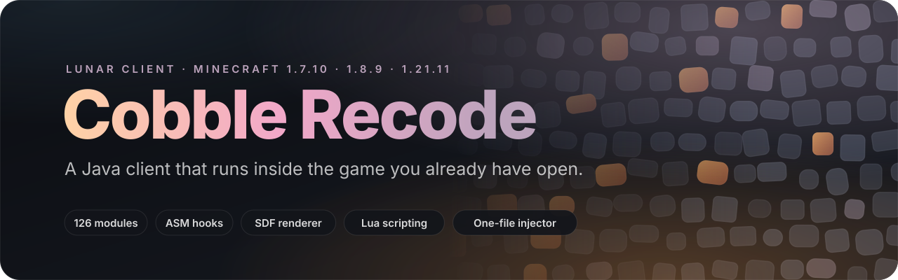
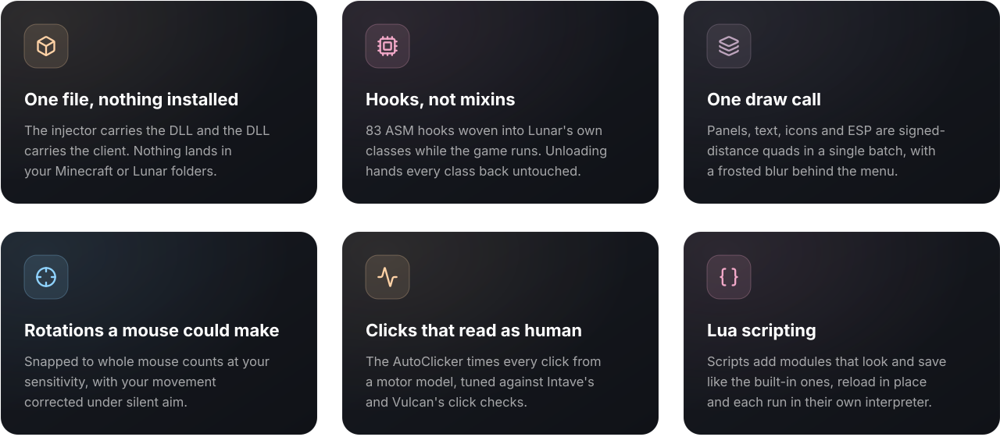
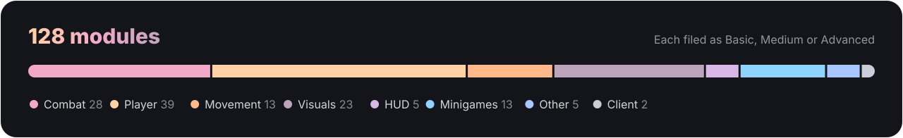

<div align="center">



<br>
<br>


**[cobble.vip](https://cobble.vip)**

[Features](#features) ·
[Getting started](#getting-started) ·
[Versions](#versions) ·
[The client](#the-client) ·
[Modules](#modules) ·
[Scripting](#scripting) ·
[Under the hood](#under-the-hood) ·
[Building](#building)

</div>

<br>

Cobble Recode is a client for **Lunar Client on Minecraft 1.8.9 and 1.21.11**
and for **CheatBreaker on 1.8.9**. It is not a mod and it is not a launcher. You start the game the way you always do,
run one small executable, and the client loads straight into the running game:
modules, menu, HUD and a Lua runtime, all from memory. The same build works on
every one of them; it finds out which one it is in and loads the modules that work
there. When you are done, hold <kbd>End</kbd> and it leaves
again, with Minecraft still running.

<br>

<br>

##  Features



<br>

<br>

##  Getting started

> [!NOTE]
> You need Windows x64 and Lunar Client on **1.8.9 or 1.21.11**, or CheatBreaker
> on **1.8.9**. That is all; the client brings everything else with it.

1. Open the game on one of those and join a world or a server.
2. Run **`cobble-injector.exe`** and pick the game window.
3. Press <kbd>Insert</kbd>. The menu opens at the top of the screen.

| Key | What it does |
| :-- | :-- |
| <kbd>Insert</kbd> | Opens and closes the menu. Rebind it on the ClickGUI module. |
| <kbd>Insert</kbd> on the multiplayer screen | Opens the Alt Manager. |
| <kbd>End</kbd>, held for half a second | Unloads the client. The config is saved and the same game can be injected again. |

Everything the client keeps lives in **`%APPDATA%\cobble`**, never in the game's
folders:

| Path | Holds |
| :-- | :-- |
| `cobble.cfg` | Every module, setting, bind and HUD position, written on unload and read on the next injection |
| `configs/` | Named configs from the menu |
| `scripts/` | Lua scripts; the injector ships the examples here |
| `cobble.scripts.cfg` | Which scripts are on, and what they stored |
| `alts.json` | Accounts saved in the Alt Manager, sealed with DPAPI to your Windows user |
| `fonts/` | Extra `.ttf` and `.otf` fonts for the HUD |
| `cobble.log` | One log per session; every startup stage reports its timing or why it failed |

> [!TIP]
> If something looks off, `cobble.log` says which hook was skipped and why, and
> which handler threw.

<br>

<br>

##  Versions

| | 1.8.9 | 1.21.11 | CheatBreaker 1.8.9 |
| :-- | :-: | :-: | :-: |
| **Modules** | 122 | 121 | as 1.8.9 |
| **Game names** | MCP | Fabric intermediary, retargeted | CheatBreaker's own, recovered at build time |

Most modules are written once and run on both. A few only make sense on one
side of the 1.9 combat update, and the client hides them where they do not:

| Only on 1.21.11 | Only before the combat update |
| :-- | :-- |
| AutoAnchor, CrystalAura, AutoTotem, WindCharge: their items are not in 1.8.9 | AutoBlock and BlockHit (no sword blocking), Regen and PotionSaver (servers tick players on their own clock), AutoBackstab (HCF is played on 1.8) |

BedPlates does not load on 1.21.11 yet.

On 1.21.11 the client knows its way around what Lunar runs there: chunks are
built by Sodium, which Xray hooks directly, and Lunar's cosmetic cloaks give way
to the Cape module's when you pick one.

<br>

<br>

##  The client

### The menu

One pill-shaped tab bar and one card, centred at the top of the screen and scaled
with Minecraft's GUI scale. Each row carries the module's icon, name, keybind
chip, description and a toggle; a row with settings opens its own page in place.
A search field finds any module from any tab.

| Tab | What lives there |
| :-- | :-- |
| **Combat** | Everything that fights |
| **Player** | Inventory, building, packets, and the Movement modules |
| **Visuals** | ESP, world overlays, and the HUD modules |
| **Other** | Minigames, the client modules, and the utilities that fit nowhere else |
| **Scripts** | Every Lua file found, with a switch and a reload for each |
| **Settings** (the gear) | Configs, the accent colour, the backdrop blur, reloading, the data folder, Panic and Unload |

**One accent drives the client.** The colour picked under Settings is what the
menu, the HUD and the ESP draw with, and scripts can read it too. **Panic** turns
every module off at once; **Unload** detaches the client without the key.

### The HUD

While the menu is open, the watermark, the module list and the notifications can
be dragged anywhere and resized from their corner. Each one anchors to the screen
edge it sits against, so dropped on the other side it mirrors and keeps growing
away from that edge. The layout is saved with the config.

### Alt Manager

Switch accounts without restarting the game. Five ways in, plus a way back to the
account the game was launched with:

| Method | How |
| :-- | :-- |
| **Microsoft** | The OAuth flow, through your browser |
| **Refresh** | A Microsoft refresh token |
| **Token** | Minecraft access tokens, one or many |
| **Cookie** | Browser cookies exported as Netscape `.txt` or JSON |
| **Offline** | Any name, for offline-mode servers |

### Radar

A searchable list of everybody in a loaded chunk, and everything the client knows
about one of them: gear, enchantments, effects and what they have been holding,
next to a real 3D model of their skin that you can turn with the mouse.

<br>

<br>

##  Modules



Every module is filed as

 or
,
so a tab can show only what you are after. Modules tagged *1.21* or *1.8* are
only shown on those versions; see [Versions](#versions).

<details>
<summary><b>Combat</b> · 28 modules</summary>
<br>

| Module | Tier | What it does |
| :-- | :-: | :-- |
| **AimAssist** |  | Pulls your aim toward the nearest target |
| **AttributeSwap** |  | Swaps to your best sword for the hit, then back |
| **AutoAnchor** |  | Places, charges and sets off a respawn anchor, with an aim assist so no use misses · *1.21* |
| **AutoAim** |  | Aims bows and rods where the target will be |
| **AutoBackstab** |  | HCF rogue backstabs, from the front or swapping to the golden sword when their back turns · *1.8* |
| **AutoBlock** |  | Blocks with the sword between hits, in custom, swap or predict timing · *1.8* |
| **AutoClicker** |  | Clicks for you while you hold left, on a human timing model |
| **AutoFeed** |  | Stops attacks that would finish an enemy |
| **Backtrack** |  | Delays incoming packets so you hit where targets were |
| **BlockHit** |  | Blocks between hits on the beat of your clicks · *1.8* |
| **Criticals** |  | Hops on the hit so the next swings crit |
| **CrystalAura** |  | Places and breaks end crystals where you look, or on its own by the damage each would do · *1.21* |
| **Displace** |  | Turns on the hit so the knockback throws them sideways |
| **Fisherman** |  | Paces swings and forward movement on the nearest target to chain knockback |
| **HitBoxes** |  | Expands entities' hitboxes |
| **HitSelect** |  | Holds hits back until they land for more |
| **JumpReset** |  | Jumps on the tick a hit lands so the knockback carries |
| **KeepSprint** |  | Keeps sprinting through your own hits |
| **KillAura** |  | Attacks entities around you without aiming at them |
| **LagRange** |  | Lags your connection only while a target is in range |
| **Piercing** |  | Hits the target through blocks and other entities in reach |
| **Reach** |  | Hits players a little past vanilla's reach |
| **Reduce** |  | Attacks back when hit to cut the knockback |
| **RightClicker** |  | Clicks right for you while you hold it |
| **SilentAura** |  | Aims at and hits nearby players without moving your view, waiting out the attack cooldown |
| **TriggerBot** |  | Attacks whatever the crosshair is already on |
| **Velocity** |  | Cuts knockback by a share, a jump reset, a delay or a hard reset, or raises it to kite |
| **WTap** |  | W-taps every landed hit |

</details>

<details>
<summary><b>Player</b> · 39 modules</summary>
<br>

| Module | Tier | What it does |
| :-- | :-: | :-- |
| **AntiAFK** |  | Keeps you from being kicked for idling |
| **AntiFall** |  | Prevents you from falling into the void |
| **ArmorSwitch** |  | Swaps between two armor sets |
| **AutoArmor** |  | Puts on the best armor you carry, openly, gliding the cursor or silently |
| **AutoDeflect** |  | Hits incoming fireballs back |
| **AutoFish** |  | Fishes for you |
| **AutoPearl** |  | Throws a pearl to where an enemy's will land |
| **AutoRefill** |  | Refills the hotbar with soup and pots |
| **AutoSwap** |  | Moves to the next block stack when one runs out |
| **AutoTool** |  | Swaps to the fastest tool for whatever you are breaking |
| **AutoTotem** |  | Keeps a totem in your off hand · *1.21* |
| **BedNuker** |  | Breaks beds within reach, through walls |
| **Blink** |  | Holds packets back, inbound, outbound or both, and lets them go at once |
| **BlockIn** |  | Surrounds you with blocks |
| **BridgeAssist** |  | Sneaks at the edge and aims at the face you are bridging off |
| **BridgeNuker** |  | Breaks the blocks enemies bridge with |
| **Buffer** |  | Holds incoming packets and plays them back later |
| **Clutch** |  | Turns to a face within reach and blocks the fall |
| **DelayRemover** |  | Removes the hit and jump delays |
| **FakeLag** |  | Delays inbound, outbound or both kinds of packets |
| **FastMine** |  | Shortens the wait between blocks and speeds up the break |
| **FastPlace** |  | Removes the four tick wait between right clicks |
| **FireballBoost** |  | Throws a fireball at your feet to launch you |
| **FireballPearl** |  | Throws an ender pearl and a fireball straight up |
| **Freecam** |  | Moves the camera away from your body |
| **GhostHand** |  | Interacts with blocks behind entities and walls |
| **HeadHitter** |  | Places a block overhead so jumps hit the ceiling |
| **HideWindow** |  | Keeps a container open while the screen stays in game |
| **InventoryManager** |  | Sorts the inventory, equips armor and drops junk |
| **MLG** |  | Places water under you to cancel fall damage |
| **NoFall** |  | Prevents fall damage |
| **NoItemRelease** |  | Keeps using the item after you let go |
| **PotionSaver** |  | Saves your potion effects while standing still · *1.8* |
| **Regen** |  | Regenerates health quicker · *1.8* |
| **Scaffold** |  | Places blocks under you as you walk |
| **Stealer** |  | Takes items out of chests |
| **ThrowDebuff** |  | Throws the debuff potions on your hotbar |
| **ThrowPots** |  | Uses the healing items on your hotbar |
| **WindCharge** |  | Throws a wind charge at your feet for the jump · *1.21* |

</details>

<details>
<summary><b>Movement</b> · 13 modules</summary>
<br>

| Module | Tier | What it does |
| :-- | :-: | :-- |
| **FastStop** |  | Stops the slide when you let go of the keys |
| **Fly** |  | Flies where the keys point, rising with jump and sinking with sneak |
| **InvMove** |  | Walks while a screen is open, and turns with the arrow keys |
| **LongJump** |  | Jumps much further than normal |
| **NoSlow** |  | Walks at full speed while using items |
| **NullMove** |  | The last key pressed wins when both directions are held |
| **Parkour** |  | Jumps for you at the edge of blocks |
| **SafeWalk** |  | Stops you from falling off edges |
| **Speed** |  | Increases your movement speed |
| **Sprint** |  | Keeps sprinting while moving |
| **Stasis** |  | Freezes your position on the server |
| **Step** |  | Steps up full blocks |
| **Timer** |  | Speeds up or slows down the game tick |

</details>

<details>
<summary><b>Visuals</b> · 23 modules</summary>
<br>

| Module | Tier | What it does |
| :-- | :-: | :-- |
| **AntiDebuff** |  | Removes blindness and nausea, and slowness if you let it |
| **AntiInvis** |  | Shows invisible players |
| **BedPlates** |  | Shows the blocks defending each bed |
| **BlockESP** |  | Highlights chosen blocks |
| **Cape** |  | Gives you a cape, animated ones included |
| **Chams** |  | Draws players through walls |
| **CuteVisuals** |  | Heart and dot trail, and a burst when a bed goes |
| **ESP** |  | Outlines, tracers and off-screen arrows for entities |
| **Explosions** |  | Shows the explosion radius of TNT |
| **FreeLook** |  | Looks around without turning your player |
| **Fullbright** |  | Lights up the dark |
| **Indicators** |  | Points at incoming arrows, pearls and fireballs |
| **ItemESP** |  | Highlights dropped items |
| **Nametags** |  | Custom nametags with health, distance and armor |
| **NoCameraClip** |  | Keeps the third person camera out of walls |
| **Pointers** |  | Arrows around the crosshair toward nearby players |
| **SpawnerFinder** |  | Labels mob spawners through walls |
| **StorageESP** |  | Highlights chests and other containers |
| **TargetESP** |  | Marks the current combat target |
| **TargetHud** |  | A panel for whoever you are fighting |
| **Tracers** |  | Lines from the crosshair to players |
| **Trajectories** |  | Draws where the projectile in your hand lands |
| **Xray** |  | See ores through the ground, deepslate and nether ores included |

</details>

<details>
<summary><b>HUD</b> · 5 modules</summary>
<br>

| Module | Tier | What it does |
| :-- | :-: | :-- |
| **Health** |  | Displays your health in the center of your screen |
| **Interface** |  | Module list and active potion effects |
| **Notifications** |  | Cards for what the client and the scripts have to say |
| **Radar** |  | Everybody in a loaded chunk, and what they are carrying |
| **Watermark** |  | The client's name in the theme's gradient |

</details>

<details>
<summary><b>Minigames</b> · 13 modules</summary>
<br>

| Module | Tier | What it does |
| :-- | :-: | :-- |
| **ArmedAimbot** |  | Aims the gun in BedWars Armed mode |
| **AutoChest** |  | Scroll up to deposit and down to steal |
| **AutoWho** |  | Runs /who for you |
| **BardHelper** |  | Cycles the HCF bard buff items on your hotbar |
| **BedDefender** |  | Covers your bed with blocks |
| **BedwarsUtils** |  | BedWars alerts and utilities |
| **Deposit** |  | Puts resources and items into nearby chests |
| **MurderMystery** |  | Finds the murderer and the bow in Murder Mystery |
| **NukeDefend** |  | Replaces the blocks enemies break around your bed |
| **Opsec** |  | Adds ping in the BedWars lobby so it can't identify you |
| **PartyDodger** |  | Dodges enemies in the BedWars queue |
| **Quickbuy** |  | Buys BedWars shop items with keybinds |
| **SkywarsUtils** |  | Strength alerts and auto echo for SkyWars |

</details>

<details>
<summary><b>Other</b> · 5 modules</summary>
<br>

| Module | Tier | What it does |
| :-- | :-: | :-- |
| **AntiBot** |  | Filters out the server's fake players |
| **Anticheat** |  | Tries to detect cheaters |
| **LagDetect** |  | Detects packet loss |
| **NickBot** |  | Claims matching random nicknames from JSON rules |
| **Teams** |  | Who counts as a teammate |

</details>

<details>
<summary><b>Client</b> · 2 modules</summary>
<br>

| Module | Tier | What it does |
| :-- | :-: | :-- |
| **AltManager** |  | Log in with another account |
| **ClickGUI** |  | Opens the menu, so its bind lives with everything else |

</details>

<br>

<br>

##  Scripting

A script is a `.lua` file in `%APPDATA%\cobble\scripts`. It can declare modules
that the rest of the client cannot tell from its own: same tabs, same rows, same
`cobble.cfg`, same module list. The **Scripts** tab switches each file on and
reloads it in place.

```lua
cold.script { name = "Aura", version = "1.0", author = "you" }

local aura = cold.module {
    name = "ScriptAura",
    category = "combat",
    subcategory = "advanced",
    icon = "swords",
    settings = {
        { name = "Range", type = "number", value = 3.0, min = 1.0, max = 6.0, decimals = 2 },
    },
}

function aura.onTick()
    local target = cold.entities.target({ range = aura.settings.Range, players = true }, "distance")
    if not target then return end

    local yaw, pitch = cold.rotation.aimAt(target:aimPoint(0.12))
    cold.rotation.set(yaw, pitch, { speed = 180, silent = true, priority = 5 })

    -- Swing only once the rotation the server holds covers the target.
    local sentYaw = cold.rotation.sent()
    if math.abs(cold.util.angleDiff(sentYaw, yaw)) < 4 then target:attack() end
end
```

| The API reaches | |
| :-- | :-- |
| **The game** | the player, the entities around you, the world and its blocks, the inventory, the input state |
| **Aim** | the rotation engine, with the same mouse-count snapping the modules get |
| **The client** | chat, commands, notifications, the theme, friends, configs, sounds |
| **Drawing** | HUD elements players can drag, and the menu's own renderer in 2D and in 3D |
| **Memory** | storage that survives restarts |

Each script runs in its own interpreter, so one failing cannot reach another, and
any callback is stopped after 250 ms because it all runs on the render thread.

The shipped scripts are the best tour: [`example.lua`](scripts/example.lua) walks
through the API, [`aura.lua`](scripts/aura.lua) is a complete rotation-gated aura,
and [`selftest.lua`](scripts/selftest.lua) exercises everything and reports what
failed.

```mermaid
flowchart LR
    injector["cobble-injector.exe<br/>picks the game"] -->|LoadLibrary| dll["cobble.dll<br/>inside javaw.exe"]
    dll -->|finds the JVM| loader["MemoryLoader<br/>the client image, from memory"]
    loader --> boot["Boot"]
    boot -->|picks the version| adapter["Version adapter<br/>and its hook table"]
    adapter -->|JVMTI retransform| patcher["Patcher<br/>ASM"]
    patcher --> bridge["Bridge<br/>in the game's class loader"]
    bridge --> hooks["Hooks"]
    hooks --> client["Modules, menu, HUD, Lua"]
```

<br>

<br>

##  Under the hood



<table>
<tr>
<td width="50%" valign="top">

#### Loading

The DLL finds the game's JVM, defines a class loader that serves the compiled
client straight out of the DLL, and starts it beside Minecraft's own classes.
Nothing is extracted next to the game.

</td>
<td width="50%" valign="top">

#### Hooks

Each hook names a method of the classes Lunar runs, its mixins (and OptiFine or
Sodium) already applied, and a point in it: its head, its returns, around one instruction, or in
place of one. The patcher writes the call with ASM and the classes are
retransformed while the game runs.

</td>
</tr>
<tr>
<td width="50%" valign="top">

#### The bridge

Game classes cannot see the client's loader, so a small class is generated into
the game's loader with one method handle per hook. Every call traps what the
client throws: the game carries on as if the hook never ran, and a hook that keeps
failing is switched off.

</td>
<td width="50%" valign="top">

#### Unloading

The handles are pointed at no-ops, every class is retransformed back to the
original, the input is handed back and the DLL frees itself. The same game can be
injected again right away.

</td>
</tr>
<tr>
<td width="50%" valign="top">

#### One build, two versions

The modules that need nothing version-specific are written once, against the
client's own view of the game. The rest is 1.8.9 code, rewritten at build time
for 1.21.11 from a table of renames and small shims. Each version's adapter supplies the hooks and the game view.

</td>
<td width="50%" valign="top">

#### Linkage

After the build, every class is checked against each version's game classes:
every reference must resolve and every method must verify. What passes is that
version's module list; what does not stays out, with the reason in a report,
instead of failing in game.

</td>
</tr>
<tr>
<td width="50%" valign="top">

#### Rendering

Every primitive is a quad carrying its own signed-distance shape, so a frame of
menu, HUD and ESP is one draw call unless a clip or a texture breaks it. Text
comes from a distance-field atlas, and the menu's backdrop is a Kawase blur.

</td>
<td width="50%" valign="top">

#### Rotations

A real mouse can only turn the player in whole counts of one step set by the
sensitivity, and anticheats measure exactly that. The engine plans in degrees and
snaps to that grid before anything reaches the player.

</td>
</tr>
</table>

<br>

<br>

##  Building

You need Windows x64, the MSVC C++ toolchain, CMake 3.21 or newer, a JDK 17 or
newer, and Lunar Client with 1.8.9 and 1.21.11 each launched once: the build
compiles against the classes Lunar bakes for them. Configuring fetches the public
jars into `infra/lib`.

CheatBreaker support is optional. It is built when CheatBreaker 1.8.9 has been
launched once on the machine, since its classes are named by matching its game
jar against vanilla's; without it the client builds for Lunar alone. Force it
either way with `-DCOLD_ENABLE_CB=ON|OFF`, or point at another install with
`-DCOLD_CB_DIR=<downloads folder>`.

```powershell
powershell -ExecutionPolicy Bypass -File build.ps1
```

`build.ps1` finds CMake and a JDK on its own, installing them when it has to
(pass `-NoAutoInstall` to fail instead), then configures and builds. The output is
`dist/cobble-injector.exe`, the only file anyone needs, and
`build/native/java/linkage/` holds each version's report of what did not link. The
two steps by hand:

```bash
cmake -S . -B build/native -A x64 -DCOLD_JAVA_HOME="<path to JDK>"
cmake --build build/native --config Release
```

The tests need only a JDK 17 and the jars configuring fetched, so they run on any
OS. They cover the Alt Manager's sealed accounts file and the remapper, over a
made-up game:

```bash
java tests/RunTests.java
```

<details>
<summary><b>Repository layout</b></summary>
<br>

```
src/common/        the client without Minecraft: boot, hooks, patcher, bridge,
                   events, the game view, menu, HUD, renderer, Lua, and the
                   modules written against the game view
src/legacy/        the modules and utilities written against 1.8.9
src/v1_21/         the 1.21.11 adapter, hooks, retarget rules and shims
src/v1_21_legacy/  1.21.11 hooks for the legacy modules, and the legacy
                   classes rewritten by hand for it
bootstrap/         cobble.dll: finds the JVM, loads the client, starts Boot
loader/            cobble-injector.exe
assets/            fonts, icons, shaders, capes, the Lua prelude
scripts/           example Lua scripts, embedded in the injector
infra/             vendored C++ (Dear ImGui) and the jars the client compiles against
tests/             java tests/RunTests.java; the tests themselves under unit/
docs/              the README's artwork
tools/             build helpers: the game jars, Retarget, Remap, Linkage
```

</details>

<br>

<div align="center">

<br>
<sub>Use it where it is allowed. What you do with it on someone else's server is on you.</sub>
</div>
