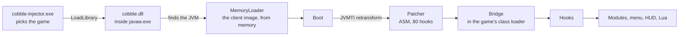

<div align="center">


<br>
<br>


**[cobble.vip](https://cobble.vip)**

[Quick start](#quick-start) •
[Modules](#modules) •
[Scripting](#scripting) •
[How it works](#how-it-works) •
[Building](#building)

</div>

<br>

Cobble Recode is a client for **Lunar Client on Minecraft 1.8.9**. It is not a mod
and it is not a launcher. You start the game the way you always do, run one small
executable, and the client loads straight into the running game: modules, menu,
HUD and a Lua runtime, all from memory. When you are done, hold <kbd>End</kbd> and
it leaves again, with Minecraft still running.

<br>

<table>
<tr>
<td width="33%" valign="top">

#### One file, nothing installed

The injector carries the DLL and the DLL carries the client. Nothing is added to
your Minecraft or Lunar folders, and there is no jar to drop anywhere.

</td>
<td width="33%" valign="top">

#### Hooks, not mixins

80 bytecode hooks are woven into Lunar's own classes with ASM through JVMTI.
A client bug can never unwind into the game, and unloading hands every class
back untouched.

</td>
<td width="33%" valign="top">

#### One draw call

Panels, text, icons, shadows and ESP are signed-distance quads in a single
batch, with a frosted Kawase blur behind the menu.

</td>
</tr>
<tr>
<td width="33%" valign="top">

#### Rotations a mouse could make

Every rotation is snapped to whole mouse counts at your sensitivity, so the
deltas share the GCD a real mouse produces. Silent rotations correct your
movement to match.

</td>
<td width="33%" valign="top">

#### 99 modules

Combat, player, movement, visuals, HUD and minigame tools, each filed as
Basic, Medium or Advanced so the menu stays readable.

</td>
<td width="33%" valign="top">

#### Lua scripting

Scripts declare modules that look and save exactly like the built-in ones,
reload in place, and each runs in its own interpreter.

</td>
</tr>
</table>

<br>

## Quick start

1. Open Lunar Client on **1.8.9** and join a world or a server.
2. Run **`cobble-injector.exe`** and pick the game window.
3. Press <kbd>Insert</kbd> to open the menu.

| Key | What it does |
| :-- | :-- |
| <kbd>Insert</kbd> | Opens and closes the menu. Rebind it on the ClickGUI module. |
| <kbd>End</kbd>, held for half a second | Unloads the client. The config is saved, and the same game can be injected again. |

Everything the client keeps lives in **`%APPDATA%\cobble`**:

| Path | Holds |
| :-- | :-- |
| `cobble.cfg` | Every module, setting and bind, written on unload and read on the next injection |
| `configs/` | Named configs saved from the menu |
| `scripts/` | Lua scripts; the injector ships the examples here |
| `cobble.scripts.cfg` | Which scripts are on, and what they stored |
| `alts.json` | Accounts saved in the Alt Manager |
| `fonts/` | Extra `.ttf` and `.otf` fonts for the HUD |
| `cobble.log` | One log per session; every startup stage reports its timing or why it failed |

> [!TIP]
> If anything looks off, `cobble.log` says which hook was skipped and why, and
> which handler threw.

<br>

## Modules

The menu has a tab for **Combat**, **Player**, **Visuals**, **Other** and
**Scripts**. Movement lives under Player, HUD under Visuals, and Minigames and
Client under Other.

<details>
<summary><b>Combat</b> · 21 modules</summary>
<br>

| Module | Tier | What it does |
| :-- | :-- | :-- |
| AimAssist | Basic | Pulls your aim toward the nearest target |
| AttributeSwap | Basic | Swaps to your best sword for the hit, then back |
| AutoAim | Advanced | Aims bows and rods where the target will be |
| AutoBlock | Medium | Blocks with the sword between hits, in custom, swap or predict timing |
| AutoClicker | Basic | Clicks for you while you hold left |
| AutoFeed | Medium | Stops attacks that would finish an enemy |
| Backtrack | Advanced | Delays incoming packets so you hit where targets were |
| BlockHit | Medium | Blocks between hits on the beat of your clicks |
| Criticals | Medium | Hops on the hit so the next swings crit |
| Displace | Advanced | Turns on the hit so the knockback throws them sideways |
| Fisherman | Medium | Paces swings and forward movement on the nearest target to chain knockback |
| HitSelect | Basic | Holds hits back until they land for more |
| JumpReset | Basic | Jumps on the tick a hit lands so the knockback carries |
| KeepSprint | Medium | Keeps sprinting through your own hits |
| LagRange | Advanced | Lags your connection only while a target is in range |
| Piercing | Advanced | Hits the target through blocks and other entities in reach |
| Reach | Advanced | Hits players a little past vanilla's reach |
| Reduce | Medium | Attacks back when hit to cut the knockback |
| TriggerBot | Medium | Attacks whatever the crosshair is already on |
| Velocity | Advanced | Cuts knockback with a jump reset, a delay or a hard reset |
| WTap | Basic | W-taps every landed hit |

</details>

<details>
<summary><b>Player</b> · 29 modules</summary>
<br>

| Module | Tier | What it does |
| :-- | :-- | :-- |
| ArmorSwitch | Medium | Swaps between two armor sets |
| AutoArmor | Basic | Puts on the best armor you carry |
| AutoDeflect | Medium | Hits incoming fireballs back |
| AutoRefill | Medium | Refills the hotbar with soup and pots |
| AutoSwap | Basic | Moves to the next block stack when one runs out |
| AutoTool | Basic | Swaps to the fastest tool for whatever you are breaking |
| BedNuker | Advanced | Breaks beds within reach, through walls |
| Blink | Advanced | Holds packets back, inbound, outbound or both, and lets them go at once |
| BlockIn | Medium | Surrounds you with blocks |
| BridgeAssist | Basic | Sneaks at the edge and aims at the face you are bridging off |
| BridgeNuker | Advanced | Breaks the blocks enemies bridge with |
| Buffer | Advanced | Holds incoming packets and plays them back later |
| Clutch | Medium | Turns to a face within reach and blocks the fall |
| DelayRemover | Basic | Removes the hit and jump delays |
| FakeLag | Advanced | Delays inbound, outbound or both kinds of packets |
| FastMine | Medium | Shortens the wait between blocks and speeds up the break |
| FastPlace | Basic | Removes the four tick wait between right clicks |
| FireballBoost | Medium | Throws a fireball at your feet to launch you |
| FireballPearl | Medium | Throws an ender pearl and a fireball straight up |
| Freecam | Basic | Moves the camera away from your body |
| GhostHand | Medium | Interacts with blocks behind entities and walls |
| HeadHitter | Medium | Places a block overhead so jumps hit the ceiling |
| HideWindow | Basic | Keeps a container open while the screen stays in game |
| InventoryManager | Basic | Sorts the inventory, equips armor and drops junk |
| MLG | Medium | Places water under you to cancel fall damage |
| NoItemRelease | Medium | Keeps using the item after you let go |
| Scaffold | Advanced | Places blocks under you as you walk |
| Stealer | Basic | Takes items out of chests |
| ThrowPots | Medium | Uses the healing items on your hotbar |

</details>

<details>
<summary><b>Movement</b> · 7 modules</summary>
<br>

| Module | Tier | What it does |
| :-- | :-- | :-- |
| FastStop | Basic | Stops the slide when you let go of the keys |
| InvMove | Basic | Walks while the inventory is open |
| NoSlow | Medium | Walks at full speed while using items |
| NullMove | Basic | The last key pressed wins when both directions are held |
| Sprint | Basic | Keeps sprinting while moving |
| Stasis | Advanced | Freezes your position on the server |
| Timer | Advanced | Speeds up or slows down the game tick |

</details>

<details>
<summary><b>Visuals</b> · 19 modules</summary>
<br>

| Module | Tier | What it does |
| :-- | :-- | :-- |
| AntiDebuff | Basic | Removes the blindness and nausea effects |
| AntiInvis | Advanced | Shows invisible players |
| BedPlates | Basic | Shows the blocks defending each bed |
| BlockESP | Advanced | Highlights chosen blocks |
| Cape | Basic | Gives you a cape, animated ones included |
| Chams | Medium | Draws players through walls |
| CuteVisuals | Basic | Heart and dot trail, and a burst when a bed goes |
| ESP | Medium | Outlines, tracers and off-screen arrows for entities |
| FreeLook | Basic | Looks around without turning your player |
| Indicators | Basic | Points at incoming arrows, pearls and fireballs |
| ItemESP | Medium | Highlights dropped items |
| Nametags | Medium | Custom nametags with health, distance and armor |
| NoCameraClip | Basic | Keeps the third person camera out of walls |
| Pointers | Basic | Arrows around the crosshair toward nearby players |
| TargetESP | Basic | Marks the current combat target |
| TargetHud | Basic | A panel for whoever you are fighting |
| Tracers | Medium | Lines from the crosshair to players |
| Trajectories | Basic | Draws where the projectile in your hand lands |
| Xray | Advanced | See ores through the ground |

</details>

<details>
<summary><b>HUD</b> · 4 modules</summary>
<br>

| Module | Tier | What it does |
| :-- | :-- | :-- |
| Interface | Basic | Module list and active potion effects |
| Notifications | Basic | Cards for what the client and the scripts have to say |
| Radar | Medium | Everybody in a loaded chunk, and what they are carrying |
| Watermark | Basic | The client's name in the theme's gradient |

</details>

<details>
<summary><b>Minigames</b> · 12 modules</summary>
<br>

| Module | Tier | What it does |
| :-- | :-- | :-- |
| ArmedAimbot | Advanced | Aims the gun in BedWars Armed mode |
| AutoChest | Medium | Scroll up to deposit and down to steal |
| AutoWho | Basic | Runs /who for you |
| BedDefender | Medium | Covers your bed with blocks |
| BedwarsUtils | Basic | BedWars alerts and utilities |
| Deposit | Medium | Puts resources and items into nearby chests |
| MurderMystery | Medium | Finds the murderer and the bow in Murder Mystery |
| NukeDefend | Advanced | Replaces the blocks enemies break around your bed |
| Opsec | Basic | Adds ping in the BedWars lobby so it can't identify you |
| PartyDodger | Basic | Dodges enemies in the BedWars queue |
| Quickbuy | Basic | Buys BedWars shop items with keybinds |
| SkywarsUtils | Basic | Strength alerts and auto echo for SkyWars |

</details>

<details>
<summary><b>Other</b> · 5 modules</summary>
<br>

| Module | Tier | What it does |
| :-- | :-- | :-- |
| AntiBot | Basic | Filters out the server's fake players |
| Anticheat | Medium | Tries to detect cheaters |
| LagDetect | Basic | Detects packet loss |
| NickBot | Advanced | Claims matching random nicknames from JSON rules |
| Teams | Basic | Who counts as a teammate |

</details>

<details>
<summary><b>Client</b> · 2 modules</summary>
<br>

| Module | Tier | What it does |
| :-- | :-- | :-- |
| AltManager | Basic | Log in with another account |
| ClickGUI | Basic | Opens the menu, so its bind lives with everything else |

</details>

<br>

## Scripting

A script is a `.lua` file in `%APPDATA%\cobble\scripts`. It can declare modules
that the rest of the client cannot tell from its own: same tabs, same menu rows,
same `cobble.cfg`, same module list. The **Scripts** tab switches each file on
and reloads it in place.

```lua
cold.script { name = "Aura", version = "1.0", author = "you" }

local aura = cold.module {
    name = "ScriptAura",
    category = "combat",
    subcategory = "advanced",
    icon = "swords",
    settings = {
        { name = "Range", type = "number", value = 3.0, min = 1.0, max = 6.0, decimals = 2 },
    },
}

function aura.onTick()
    local target = cold.entities.target({ range = aura.settings.Range, players = true }, "distance")
    if not target then return end

    local yaw, pitch = cold.rotation.aimAt(target:aimPoint(0.12))
    cold.rotation.set(yaw, pitch, { speed = 180, silent = true, priority = 5 })

    -- Swing only once the rotation the server holds covers the target.
    local sentYaw = cold.rotation.sent()
    if math.abs(cold.util.angleDiff(sentYaw, yaw)) < 4 then target:attack() end
end
```

The API reaches the player, the entities around you, the world and its blocks,
the inventory, the rotation engine, the input state, chat, notifications,
persistent storage, HUD elements you can drag, and the same renderer the menu draws with,
in 2D and in 3D. Every callback is stopped after 250 ms, because it all runs on
the render thread.

The scripts that ship with the client are the best tour:
[`example.lua`](scripts/example.lua) walks through every part of the API,
[`aura.lua`](scripts/aura.lua) is a complete rotation-gated aura, and
[`selftest.lua`](scripts/selftest.lua) exercises everything and reports what
failed. [`docs/lua-scripting.md`](docs/lua-scripting.md) explains how it is put
together.

<br>

## How it works



- **Loading.** The DLL finds the game's JVM, defines a class loader that serves
  the compiled client straight out of the DLL, and starts it beside Minecraft's
  own classes. Nothing is extracted next to the game.
- **Hooks.** Each hook names a method of Lunar's baked classes, with mixins and
  OptiFine already applied, and a point in it: its head, its returns, around one
  instruction, or in place of one. The patcher writes the call with ASM and the
  classes are retransformed while the game runs.
- **The bridge.** Game classes cannot see the client's loader, so a small class is
  generated into the game's loader with one method handle per hook. Each call
  traps anything the client throws: an injection then carries on as if it never
  ran, and a redirect performs the instruction it replaced. A hook that keeps
  failing is switched off and logged.
- **Unloading.** The handles are pointed at no-ops, the classes are
  retransformed back to the originals, input is handed back and the DLL frees
  itself.

`docs/` is a vault of everything in this project that took more than one try.
Start at [`docs/MAP.md`](docs/MAP.md).

<br>

## Building

You need Windows x64, the MSVC C++ toolchain, CMake 3.21 or newer and a JDK 17 or
newer. Configuring fetches the public jars into `infra/lib`; the MCP-named
`minecraft-1.8.9-mcp.jar` has no public source and has to be copied there by hand.

```powershell
powershell -ExecutionPolicy Bypass -File build.ps1
```

`build.ps1` finds CMake and a JDK on its own, installing them when it has to
(pass `-NoAutoInstall` to fail instead), then configures and builds. The output is
`dist/cobble-injector.exe`, the only file anyone needs. The two steps by hand:

```bash
cmake -S . -B build/native -A x64 -DCOLD_JAVA_HOME="<path to JDK>"
cmake --build build/native --config Release
```

<details>
<summary><b>Repository layout</b></summary>
<br>

```
src/cobble/        the Java client
  boot/              entry points the DLL calls, hooks, patcher, bridge
  core/  event/      config, maths, logging; the event bus
  game/  hook/       views over Minecraft state; the hook handlers
  module/            modules, one package per category
  render/  ui/       SDF renderer; menu, HUD, radar
  script/            the Lua API
  util/              blocks, fonts, items, packets, raytracing, rotations, teams
bootstrap/         cobble.dll: finds the JVM, loads the client, starts Boot
loader/            cobble-injector.exe
assets/            fonts, icons, shaders, capes, the Lua prelude
scripts/           example Lua scripts, embedded in the injector
infra/             vendored C++ (Dear ImGui) and the jars the client compiles against
docs/              notes on everything that was hard
tools/             build helpers
legacy/            the old C++ payload and its tools
```

</details>

<br>

## Credits

The silent-rotation model, a server rotation kept apart from the camera and
composed with your own mouse movement, comes from Rise, and so do the Interface
and TargetHud. Several player and render modules began as ports of
[Raven-b](https://codeberg.org/strangerrrrs/raven-bS). Their designs are theirs and
their licences differ from this repository's, so **check them before you
redistribute**.

Built with [ASM](https://asm.ow2.io/) (BSD-3-Clause), [LuaJ](https://github.com/luaj/luaj)
(MIT) and [Dear ImGui](https://github.com/ocornut/imgui) (MIT). The interface is
set in [Geist](https://vercel.com/font) and
[JetBrains Mono](https://www.jetbrains.com/lp/mono/) (OFL), with icons from
[Lucide](https://lucide.dev/) (ISC). The HUD fonts in `assets/cobble/fonts` each
carry their own licence.

<br>

<div align="center">
<sub>Use it where it is allowed. What you do with it on someone else's server is on you.</sub>
</div>
